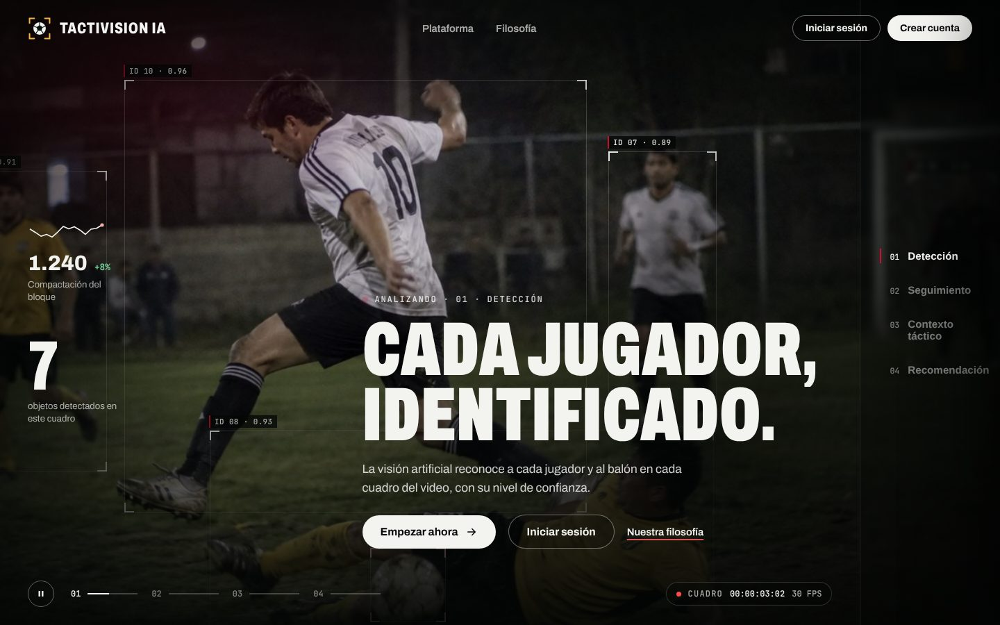
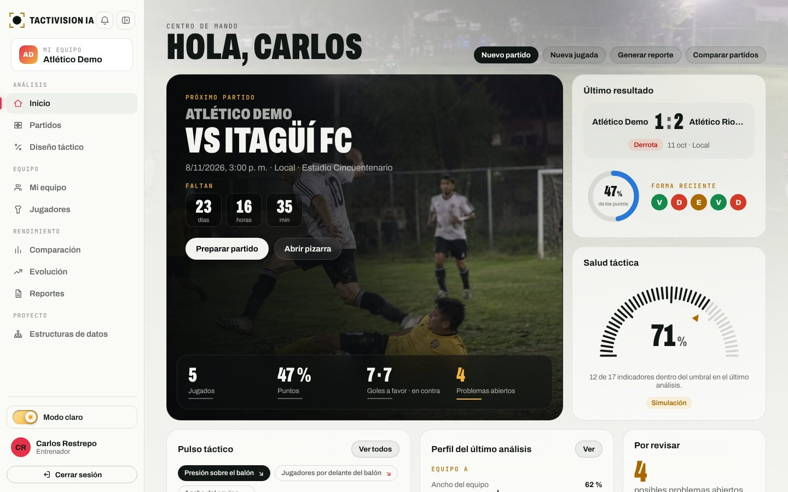
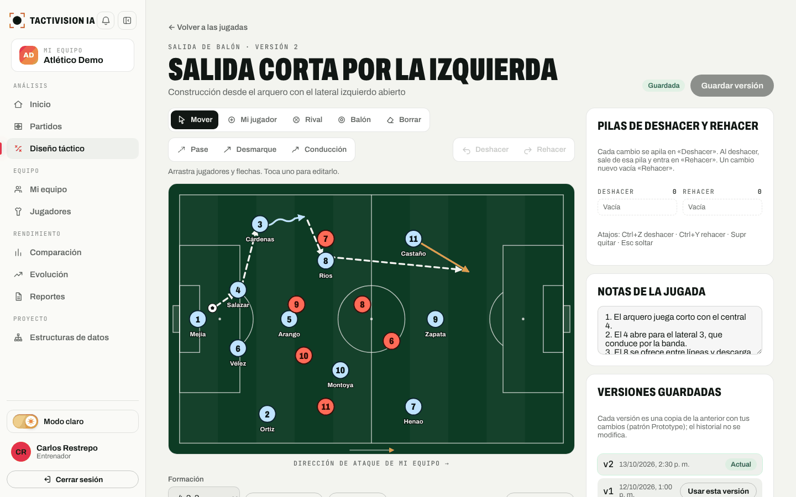
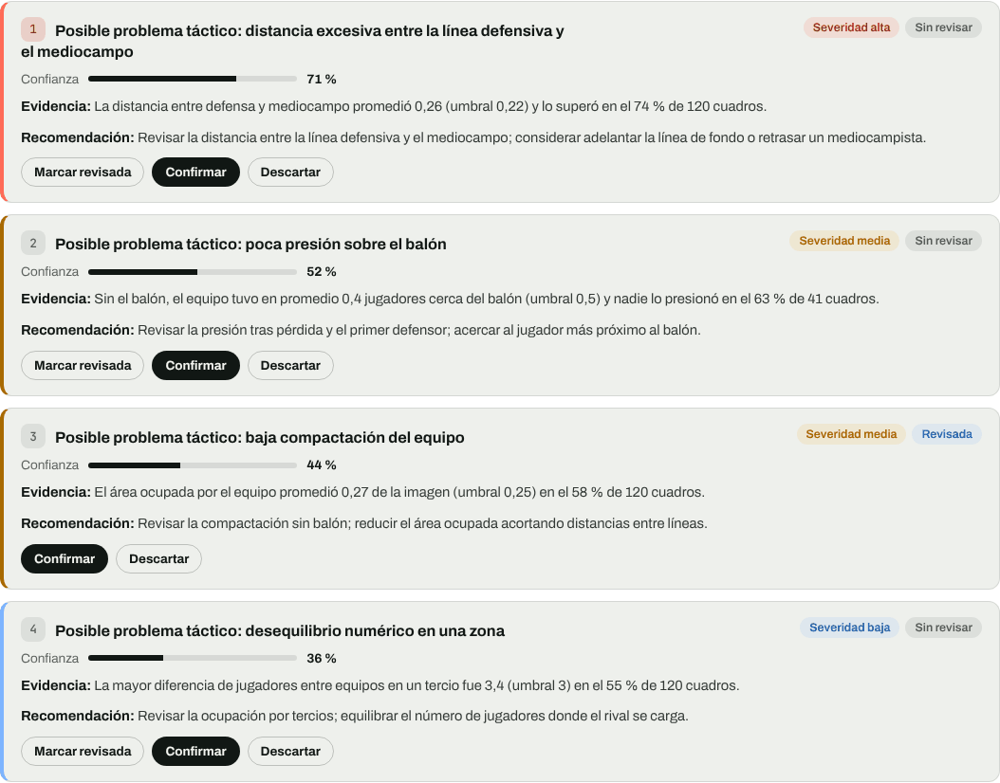
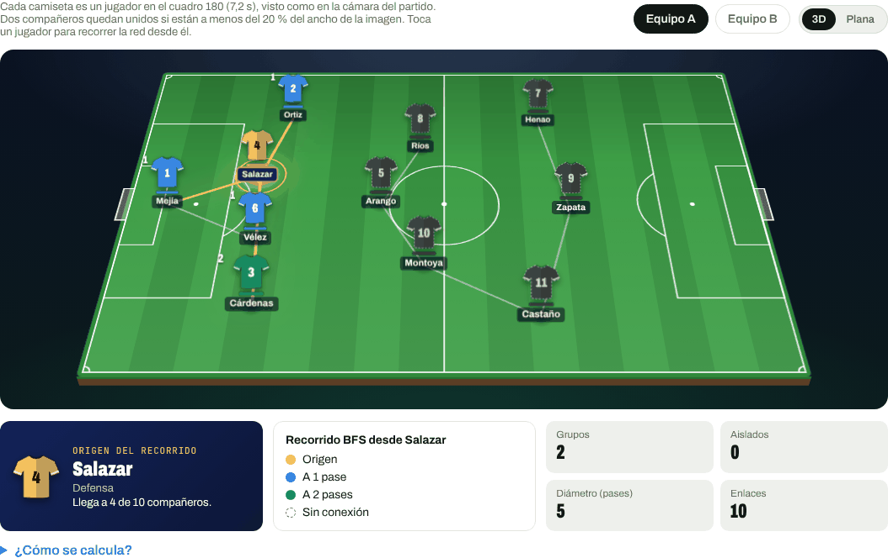
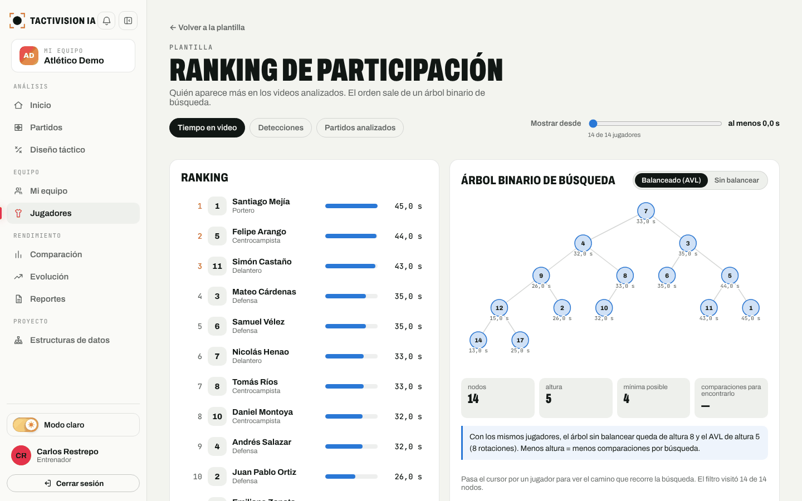
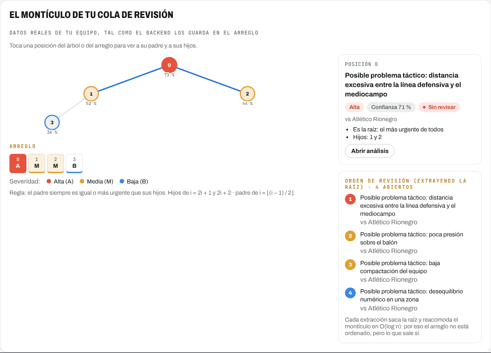
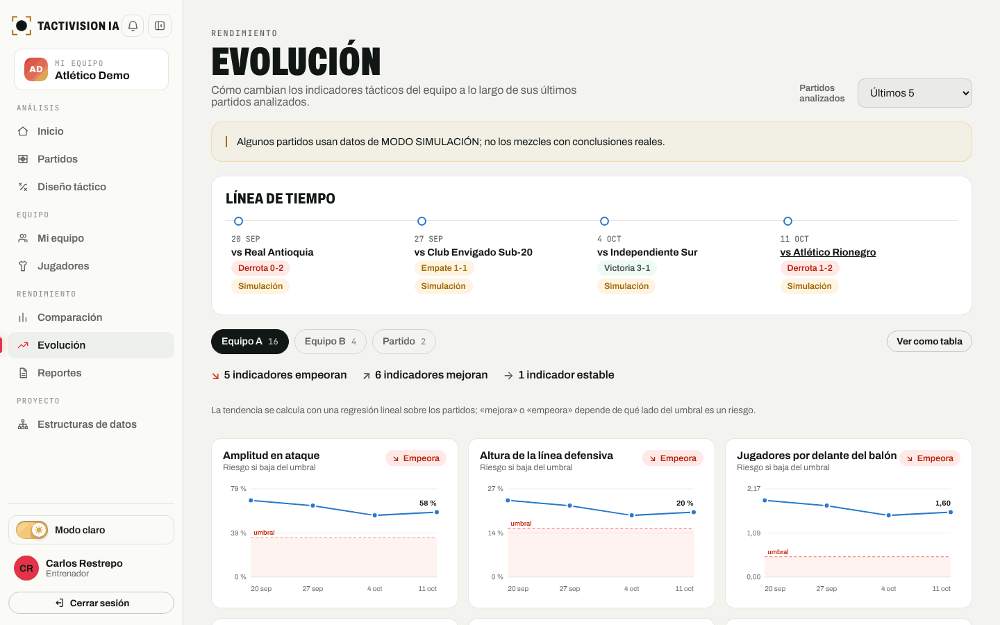
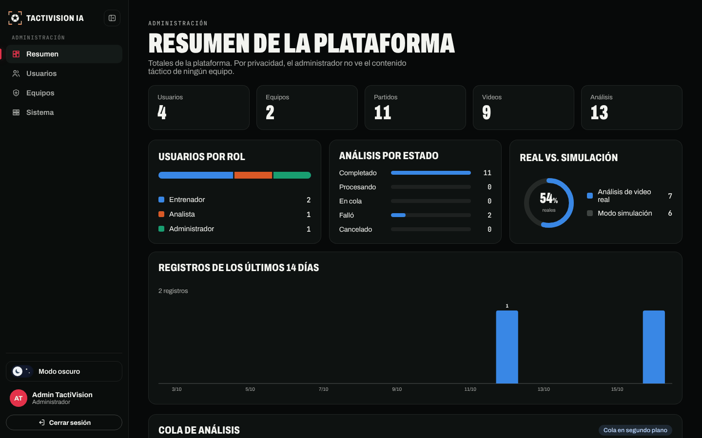
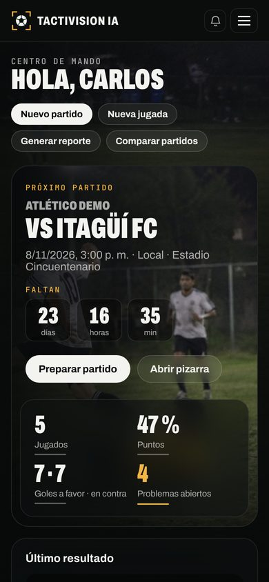

# TactivisionSoccerIA-frontend

[](https://github.com/davidcampino06/TactivisionSoccerIA-frontend/actions/workflows/ci.yml)

Aplicación web de **TactiVision IA**: el cuerpo técnico de un equipo sube los videos de sus partidos,
la inteligencia artificial detecta y sigue a los jugadores, y la app muestra indicadores tácticos,
posibles problemas con su evidencia y nivel de confianza, y recomendaciones. Además tiene pizarra
táctica, plantilla, ranking, comparación, evolución y reportes.

React 19 + TypeScript + Vite. Se comunica **solo con el Backend** (`VITE_API_URL`); nunca llama al
servicio de IA directamente.

Integración continua (GitHub Actions, `.github/workflows/ci.yml`): en cada push a `main` y en cada
pull request se ejecutan lint, pruebas (Vitest) y build.



**Estilo visual:** la app flota sobre fotos de estadios reales (una por sección: de noche en el modo
oscuro y de día en el claro, `public/backdrop`, licencia Unsplash) y cada panel y botón es de vidrio
esmerilado (`src/glass.css`). Títulos en Anton (letra de camiseta, condensada) y texto en Inter.

## Pantallas

| | |
|---|---|
|  |  |
| **Centro de mando**: próximo partido con cuenta regresiva, último resultado, salud táctica, tendencia de indicadores y posibles problemas por revisar. | **Pizarra táctica**: jugadores, rivales, balón y flechas de pase, desmarque y conducción; deshacer y rehacer con dos pilas, y versiones guardadas. |
|  |  |
| **Resultado del análisis**: cada posible problema llega con evidencia, confianza y recomendación; el usuario lo revisa, confirma o descarta. | **Red de cercanía en 3D**: el grafo de apoyos entre compañeros y el recorrido BFS desde el jugador elegido (a cuántos pases cortos está cada uno). |
|  |  |
| **Ranking de participación**: el orden sale de un árbol binario de búsqueda; se compara el árbol AVL con el árbol sin balancear. | **Montículo**: la cola de revisión del backend (heap) dibujada como árbol y como arreglo. |
|  |  |
| **Evolución**: cada indicador partido a partido, con su umbral y si mejora o empeora. | **Administración** (modo oscuro): totales de la plataforma, usuarios, equipos y estado del sistema, sin acceso al contenido táctico de ningún equipo. |

<p align="center"></p>

La interfaz funciona en celular (menú lateral desplegable) y tiene modo claro y oscuro.

## Qué puede hacer cada rol

| Rol | Puede |
|---|---|
| **Entrenador** (`COACH`) | Crear su equipo y compartir el código de invitación; registrar partidos, jugadores y eventos; subir videos y lanzar análisis (con video real o en modo simulación); revisar posibles problemas; diseñar jugadas; generar reportes; comparar partidos; ver la evolución. |
| **Analista** (`ANALYST`) | Unirse a un equipo con el código de invitación y trabajar en sus partidos, análisis, jugadas y reportes. |
| **Administrador** (`ADMINISTRATOR`) | Ver totales de la plataforma, activar o desactivar cuentas, cambiar roles, ver equipos y el estado del sistema. **No** ve partidos, análisis ni jugadas (privacidad de cada equipo). |

## Rutas

| Ruta | Pantalla |
|---|---|
| `/` | Página de inicio (sin sesión) o redirección al panel |
| `/panel` | Centro de mando del equipo |
| `/equipo` | Crear el equipo o unirse con código; miembros e invitación |
| `/partidos`, `/partidos/:id` | Calendario, resultados, eventos, videos y análisis de cada partido |
| `/analisis/:id` | Resultado del análisis: problemas, red de cercanía, indicadores |
| `/jugadores`, `/jugadores/:id`, `/jugadores/ranking` | Plantilla con búsqueda instantánea, ficha y ranking. Cada jugador puede estar disponible, lesionado, suspendido o no disponible (motivo personal u otro), con el motivo y la fecha estimada de regreso; ese día la campana lo recuerda y el diseño táctico lo marca con una cruz roja |
| `/diseno-tactico`, `/diseno-tactico/:id` | Jugadas y pizarra táctica |
| `/comparacion`, `/evolucion` | Comparar dos partidos; tendencia de cada indicador |
| `/reportes`, `/reportes/:id` | Reportes con la foto de los datos del momento en que se generaron |
| `/estructuras` | Las estructuras de datos del proyecto, explicadas y en uso |
| `/perfil` | Datos personales y cambio de contraseña |
| `/admin`, `/admin/usuarios`, `/admin/equipos`, `/admin/sistema` | Administración |

Los enlaces de recuperación de contraseña llegan por correo y abren la app; por eso el sitio en
Render tiene la regla de reescritura `/*` → `/index.html`.

## Estructuras de datos

La página `/estructuras` explica cada una y lleva a la pantalla donde se usa:

| Estructura | Capa | Dónde se usa |
|---|---|---|
| Cola (FIFO) | Backend | Los videos se analizan en el orden en que llegan; la app muestra la posición en la cola |
| Pila (LIFO) | Frontend y backend | Deshacer y rehacer de la pizarra (`src/structures/Stack.ts`, `UndoHistory.ts`) e historial de versiones de cada jugada |
| Lista doblemente enlazada | Backend | Línea de tiempo del equipo: saltar al partido anterior o siguiente |
| Tabla hash | Backend | Intentos fallidos de inicio de sesión por correo y bloqueo temporal |
| Trie | Frontend | Búsqueda instantánea de jugadores por prefijo (`Trie.ts`) |
| Montículo binario | Backend | Qué posible problema revisar primero (severidad, sin revisar, confianza, fecha) |
| Árbol binario de búsqueda / AVL | Frontend | Ranking de jugadores (`BinarySearchTree.ts`) |
| Grafo + BFS | IA | Red de cercanía entre compañeros |

## Seguridad en el navegador

- **Contraseñas cifradas**: antes de salir del navegador se cifran con RSA-OAEP (clave pública del
  backend), además de viajar por HTTPS. El servidor guarda solo un hash bcrypt.
- **Reglas de contraseña** iguales a las del backend (longitud, mayúscula, número, símbolo, sin el
  nombre ni el correo, no común) con barra de fuerza.
- **Sesión**: el token JWT vence; la app lo detecta y cierra la sesión sola.
- Los errores del servidor se muestran en español y nunca exponen detalles internos.

## Ejecutar localmente

```bash
npm install
copy .env.example .env      # Linux/Mac: cp .env.example .env   → VITE_API_URL=http://localhost:8000
npm run dev                 # http://localhost:5173
```

Necesita el backend en marcha (repositorio `TactivisionSoccerIA-backend`). Para tener datos con los
que probar, la base de datos trae `sql/seed_demo.sql` (repositorio `TactiVisionSoccerIA-db`) con el
equipo **Atlético Demo**:

| Cuenta | Rol | Contraseña |
|---|---|---|
| `entrenador.demo@tactivision.co` | Entrenador | `Pizarra#Tactica26` |
| `analista.demo@tactivision.co` | Analista | `Pizarra#Tactica26` |

| Comando | Qué hace |
|---|---|
| `npm run dev` | Servidor de desarrollo |
| `npm run build` | Revisión de tipos (`tsc -b`) y build de producción en `dist/` |
| `npm run lint` | Lint con oxlint |
| `npm test` | Pruebas con Vitest |

## Estructura del código

```
src/
  api/          cliente HTTP (token, errores en español)
  app/          rutas, layout, contexto del equipo
  pages/        una página por ruta (pages/app/*)
  components/   componentes por área: analysis, auth, charts, dashboard, insights, tactics, ...
  structures/   Stack, UndoHistory, Trie, BinarySearchTree (con sus pruebas)
  security/     cifrado RSA, reglas de contraseña, sesión (con sus pruebas)
  i18n/         todos los textos en español y las etiquetas de los códigos del backend
  landing/      página de inicio
  theme/        modo claro y oscuro
```

## Pruebas (Vitest)

Las estructuras de datos propias (`src/structures/`), la seguridad del inicio de sesión
(`src/security/`, formulario de login) y la lectura de indicadores tienen pruebas unitarias:

```bash
npm test
```

| Qué se prueba | Dónde se usa | Qué comprueban las pruebas |
|---|---|---|
| `Stack` (pila inmutable) | Deshacer/rehacer del editor táctico | Orden LIFO, versiones antiguas intactas, pila vacía, límite de tamaño |
| `UndoHistory` (dos pilas) | Editor táctico | Deshacer y rehacer en orden, un cambio nuevo vacía "rehacer", capacidad máxima |
| `Trie` (árbol de prefijos) | Búsqueda instantánea de jugadores | Tildes y mayúsculas, búsqueda por prefijo, camino roto, varias palabras a la vez |
| `BinarySearchTree` (ABB / AVL) | Ranking de jugadores | Orden descendente, propiedad de búsqueda, altura del AVL frente al ABB simple, rangos que saltan subárboles |
| Reglas de contraseña | Registro, perfil y recuperación | Longitud 8 a 64, mayúscula, minúscula, número, símbolo, sin espacios, sin nombre ni correo, no común; letras con tilde y ñ; barra de fuerza |
| Cifrado RSA-OAEP | Toda contraseña que sale del navegador | Solo la clave privada correcta la descifra, cifrado distinto cada vez, UTF-8, la clave pública se pide una vez y se reintenta si el servidor cambió de clave |
| Sesión (JWT) | Cierre de sesión automático | Lee la expiración del token, detecta el vencimiento y avisa a la app |
| Formulario de login | Pantalla de inicio de sesión | La contraseña nunca queda en el HTML, botón del ojito, solo viaja cifrada, al fallar se borra solo la contraseña y el error sale en español |
| Indicadores | Panel, análisis y evolución | Del lado de riesgo de cada indicador (alto o bajo), etiquetas y unidades |

## Despliegue (Render)

Static Site · Build: `npm ci && npm run build` · Publish directory: `dist` ·
Variable: `VITE_API_URL` = URL del backend · Regla de reescritura: Source `/*`, Destination
`/index.html`, Action **Rewrite** (para que funcionen los enlaces directos como `/restablecer`).

Las capturas de este README se tomaron con los datos de demostración (`docs/capturas/`).
